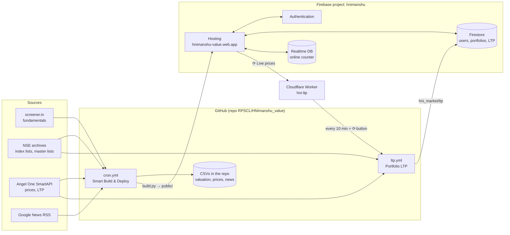

# HNImanshu — Indian stock value screener

**Live site:** https://hnimanshu-value.web.app/

A free, self-updating website that screens about 1,250 Indian stocks (NIFTY 500, Smallcap 500 and Microcap 250) on value, quality, momentum and news. It also has a login-protected **Fundamentals** section with a full personal **portfolio manager**.

Everything runs on free tiers: GitHub Actions does the work, Firebase hosts the site and stores logins and portfolios, Angel One supplies prices, and a small Cloudflare Worker keeps time.

---

## Contents

1. [What the site does](#1-what-the-site-does)
2. [How it fits together](#2-how-it-fits-together)
3. [What it is built with](#3-what-it-is-built-with)
4. [Repository layout](#4-repository-layout)
5. [The data pipeline](#5-the-data-pipeline)
6. [The two pages](#6-the-two-pages)
7. [Login, users and the database](#7-login-users-and-the-database)
8. [Portfolio and live prices](#8-portfolio-and-live-prices)
9. [Speed, offline and 2G](#9-speed-offline-and-2g)
10. [Deployment](#10-deployment)
11. [Schedules](#11-schedules)
12. [Secrets and settings](#12-secrets-and-settings)
13. [Running it on your own computer](#13-running-it-on-your-own-computer)
14. [Costs](#14-costs)
15. [Troubleshooting](#15-troubleshooting)
16. [Security notes](#16-security-notes)
17. [Old / unused files](#17-old--unused-files)

---

## 1. What the site does

| Page | Address | Who can open it | What's on it |
|---|---|---|---|
| **Screener** | `/` (`public/index.html`) | Everyone | Ranked lists for NIFTY 500, Smallcap 500, Microcap 250 and All. Scores (Piotroski F-score, quality, value, final rank), filters, 7-day news per stock, PSU / Semi-PSU tags. |
| **Fundamentals** | `/fundamentals` (`public/fundamentals.html`) | Signed-in users | Industries (industry PE, PB, ROE), **Value screen** (presets such as Deep value, Graham defensive), **Momentum**, **All Stocks**, **Methodology**, a **Historical** view (3M … 1.5Y back), and the **Portfolio** manager. |
| **Portfolio** | `/fundamentals#/portfolio` | Each user sees only their own | Buy / sell / pay in / pay out, average cost, charges, cash, closed positions, day gain with live prices, news for held stocks, and a Buy / Hold / Watch / Sell checklist per stock. |

---

## 2. How it fits together



In words:

1. **GitHub Actions (`cron.yml`)** scrapes the data, fetches prices and news, and runs `build.py`. That turns the CSVs into two static HTML pages plus some JSON files in `public/`, which are then deployed to **Firebase Hosting**.
2. The website is **static files only**. Anything per-user (login, portfolio) goes from the browser straight to **Firebase Auth / Firestore**, protected by the database rules.
3. **Live prices** for the stocks people hold come from a second, small workflow (**`ltp.yml`**). It writes one Firestore document that every portfolio page reads.
4. A **Cloudflare Worker** starts `ltp.yml` every 10 minutes in market hours, and when an admin taps **⟳** on the Portfolio page. It holds the GitHub token so the website never has to.

---

## 3. What it is built with

| Area | Tools |
|---|---|
| Data scraping | Python 3.11, `requests`, `beautifulsoup4`, `lxml`, `pandas`, `numpy`, `tqdm` |
| Prices | Angel One **SmartAPI** (`smartapi-python`, `pyotp`, `logzero`, `websocket-client`) |
| News | Google News RSS, fetched directly with `requests` and parsed with Python's own XML reader; repeats removed by `news_dedup.py` |
| Site build | `build.py` + `fundamentals.py` (Python writes the HTML, CSS and JS), minified with `htmlmin` / `rcssmin` |
| Front end | Plain HTML, CSS and JavaScript (no framework). Google Fonts (DM Sans, IBM Plex Mono), loaded without blocking. A service worker (`sw.js`) for offline use. |
| Hosting | **Firebase Hosting** (project `hnimanshu`, site `hnimanshu-value`) |
| Login | **Firebase Authentication**: Google sign-in and username + password |
| Database | **Cloud Firestore** (users, admins, portfolios, live prices); **Realtime Database** (admin-only online / visitor counter) |
| Firebase SDK | Web SDK 10.13.0 from `gstatic.com` as ES modules; Firestore and Realtime DB load only when needed |
| Automation | **GitHub Actions** (`cron.yml`, `ltp.yml`) |
| Scheduler + token keeper | **Cloudflare Workers** (free plan) with a Cron Trigger |
| Notifications | Telegram bot (run results posted to a channel) |

---

## 4. Repository layout

### Scripts that run in GitHub Actions

| File | What it does |
|---|---|
| `n500.py`, `ns500.py`, `nm250.py` | Scrape screener.in for NIFTY 500, Smallcap 500 and Microcap 250 (standalone + consolidated pages, merged). Each updates its **master CSV**, one row per stock, keeping old history. They share a scrape cache and have a circuit breaker if screener.in blocks. |
| `archive_csv.py` | Before the CSVs change, saves a dated copy into `old_csv.zip`. |
| `fetch_prices.py` | Weekly Angel One prices into `prices.csv`: latest close, closes 3M–1.5Y back, 52-week highs, split / bonus detection. Also has the shared Angel login and scrip-master helpers (downloaded once per IST day, cached in `.cache/`). |
| `fetch_news.py` | Last 7 days of headlines per stock from Google News into `multi_stock_news.csv`. 1 request per stock, at most 6 a second, pauses if Google asks it to slow down. |
| `news_dedup.py` | Spots the same story told twice ("₹59 crore" = "Rs 59 cr") and keeps the newest. Used by `fetch_news.py` and `build.py`. |
| `build.py` | Builds `public/index.html` from `HNImanshu_template.html`, writes `news.json` and the Smallcap / Microcap list files, then calls `fundamentals.py`. |
| `fundamentals.py` | Builds `public/fundamentals.html` and `fundamentals_back_<period>.json`. Holds all the Fundamentals page code: scoring, screens, portfolio and checklist. |
| `portfolio_ltp.py` | Reads every portfolio in Firestore, works out the held symbols, checks them daily against NSE's master lists, fetches LTP + previous close from Angel, and writes `hni_market/ltp`. |
| `creds.py` | Reads the Angel / Telegram credentials from environment variables (GitHub secrets) or a local `.env`. Never hardcode credentials. |

### Website source

| File | What it is |
|---|---|
| `HNImanshu_template.html` | Template for the Screener page. `build.py` fills in the data. |
| `public/auth.js` | Login popup, the Fundamentals gate, avatar menu, admin Users list, online counter, and `window.hniStore` (portfolio load / save, market prices, ⟳ refresh). Holds the public Firebase web config and `LTP_HOOK` (the Worker address). |
| `public/auth.css` | Styles for login, menus and admin windows. Follows each page's day / night theme. |
| `public/sw.js` | Service worker: offline cache and silent background updates. |
| `firebase.json` / `.firebaserc` | Hosting setup: `public/` folder, clean URLs, cache headers, target `mysite` = site `hnimanshu-value`. |
| `firebase_rules/firestore.rules` | Firestore security rules. Paste into the Firebase console (they are not deployed by the workflow). |
| `firebase_rules/database.rules.json` | Realtime Database rules. Paste into the Firebase console. |
| `ltp_worker.js` | Copy of the Cloudflare Worker code. The live copy is in the Cloudflare dashboard. |

### Workflows (`.github/workflows/`)

| File | Name in Actions | Job |
|---|---|---|
| `cron.yml` | Smart Build & Deploy | Scrape, prices, news, build, commit, deploy, Telegram |
| `ltp.yml` | Portfolio LTP | Live prices for held stocks into Firestore |

### Data files in the repo (written by the workflows)

| File | Written by | Used by |
|---|---|---|
| `nifty500_valuation.csv`, `niftysmallcap500_valuation.csv`, `niftymicrocap250_valuation.csv` | `n500` / `ns500` / `nm250` (weekly) | `build.py`, `fundamentals.py` |
| `prices.csv` | `fetch_prices.py` (weekly) | `fundamentals.py` (historical views, momentum) |
| `multi_stock_news.csv` | `fetch_news.py` (each light run) | `build.py` → `public/news.json` |
| `old_csv.zip` | `archive_csv.py` | History and backup |

### Generated website files (`public/`, rebuilt every run; don't edit by hand)

`index.html`, `fundamentals.html`, `fundamentals_back_3M|6M|9M|1Y|1_25Y|1_5Y.json`, `news.json`, `screener_sc250.json`, `screener_mc250.json`.

---

## 5. The data pipeline

`cron.yml` decides a **mode** each time it runs:

| Mode | When | Steps |
|---|---|---|
| **full** | Saturday 00:00 IST, or manual run with `1` | archive CSVs → scrape all three lists → Angel prices (if due) → build → commit → deploy → Telegram |
| **light** | All other scheduled times, or manual `0` | Angel prices (only if `prices.csv` is 5+ days old) → **fetch news** → build → commit → deploy → Telegram |
| **build** | Manual `-1` | build → commit → deploy (good for testing a code change) |
| **prices** | Manual `2` | Angel prices only, commit `prices.csv`; no build or deploy |

### What `build.py` produces

- **Screener (`index.html`):**
  - The NIFTY 500 data is inside the page.
  - Smallcap and Microcap load as separate files (`screener_sc250.json`, `screener_mc250.json`) only when you switch to them.
  - News loads from `news.json` only when needed.
- **Fundamentals (`fundamentals.html`):**
  - Today's data, slimmed down (empty fields and long histories dropped).
  - Every historical period is its own JSON file, loaded when picked.
- **`news.json`:** one compact file shared by both pages. It covers the last 7 days, up to 10 headlines per stock. Repeats are removed, and Google's long link prefix is stored once.

### Scores on the Fundamentals page (full details on the Methodology tab)

| Score | Meaning |
|---|---|
| **Value score** (0–100) | Cheapness (PE, PB, FCF yield, Graham upside) combined with quality |
| **Momentum** (0–100) | Percentile of the 3M, 6M and 12-minus-1-month returns against every stock on screen |
| **Trend** (x / 4) | How many "improving fundamentals" checks pass: profit, revenue, margin, ROCE, promoter holding, cash conversion |
| **Graham number** | √(22.5 × EPS × book value); Graham screens also check debt, 10-year profit record and NPA for banks |
| **Value-trap flags** | Weak cash conversion, new shares issued, debt warnings and similar |

---

## 6. The two pages

### Screener (`/`)
- **List switch:** NIFTY 500 / Smallcap 500 / Microcap 250 / All. The extra lists download only when picked.
- Filters, sorting, PSU / Semi-PSU tags, and news per stock.
- A **welcome popup** shows once per day (IST).
- The **Fundamentals** button asks for a login first.

### Fundamentals (`/fundamentals`)
- **Header:** ← Screener, List, PSU, Semi PSU, **Historical** + period (remembered for the browser session), **Weekly** (Telegram; work in progress), **Portfolio** (bag icon), avatar menu, day / night switch.
- **Tabs:** Industries · Value screen (defaults to *Deep value*; **Save** remembers your own filters, **Default** resets them) · Momentum (default momentum ≥ 70) · All Stocks · Methodology.
- **Stock names:** tapping any stock name opens a popup with:
  - Its **Buy / Hold / Watch / Sell** status and checklist
  - Your holding, if any
  - Value and momentum numbers
  - The last 7 days of news
  - Buy / Sell and **Open on Screener.in** buttons

  Ctrl / Cmd-click still opens Screener.in.
- **Bag icon** next to each industry name: opens Buy / Sell for that stock.
- **Phones:** a floating **Filters** button (50% visible, fades to 5% while you scroll), and Portfolio laid out like Zerodha's Holdings.

---

## 7. Login, users and the database

### Sign-in
- **Google**, or **username + password**. A username is stored inside Firebase as `username@users.hnimanshu.app`; that address is never mailed.
- **No self-registration** on the site. Accounts are made by signing in with Google, or created by you in the Firebase console.
- Sessions end **7 days** after the last sign-in.
- **Main admin:** the username `admin`. Its password is set by you in the Firebase console and is never in the code.
- **Extra admins:** made from the **Users** list in the avatar menu, by the main admin or another admin.

### Firestore collections

| Path | Holds | Who can read / write |
|---|---|---|
| `hni_users/{uid}` | username, email, provider, created, lastLogin | The user (own record), admins (all) |
| `hni_admins/{uid}` | marks extra admins | Admins write; a user can read their own |
| `hni_portfolio/{uid}` | `{txns: [...], rates: {...}, updated}` | Owner reads and writes; admins can **read** (the admin "View" in Users) |
| `hni_market/ltp` | `{asOf, prices{SYM:{ltp,prev}}, renames, missing, notListed, names, checked}` | Any signed-in user reads; only the workflow writes (service account) |

### Realtime Database (`hni/…`): admin-only green dot, bottom-left
- `presence/$sid`: who is online now (removed when they leave)
- `visitors/$hash`: one entry per visitor (a one-way hash, never the raw address)
- `meta/visitors`: the total, which can only go up by 1 at a time

**Rules:**
- `firebase_rules/firestore.rules` and `firebase_rules/database.rules.json`.
- They are pasted into the Firebase console (Firestore → Rules, Realtime Database → Rules).
- **Keep the console in step with these files.**

### Firebase web config
The config is in `public/auth.js`. It's public by design, and security comes from the rules. The Realtime Database address is picked up automatically from Hosting's `/__/firebase/init.json`.

---

## 8. Portfolio and live prices

### Portfolio model
- **Transactions:** `buy` / `sell` `{id, t, sym, qty, px, ch, date, name?, pe?, sc?}` and `in` / `out` `{id, t, amt, date}`.
- **Replay:** everything is replayed in date order using **average cost**. When a position reaches 0 it moves to **Closed**, and its trades lock: they can only be removed through *Remove* on the Closed list.
- **Overselling** is blocked as you type: the quantity turns red and Save is disabled.
- **Charges:** brokerage, STT, exchange, SEBI, stamp duty, GST and DP, using editable rates under the **₹ document** button. They're subtracted from cash.
- **Day gain:** shares bought today count from their buy price; older shares from yesterday's close.
- **New buys** save that day's PE and value score, for the checklist's "PE vs the PE you bought at".
- **Deleting anything** asks you to type **confirm**.

### Buy / Hold / Watch / Sell checklist
Up to 15 yes / no checks in four groups:
- **Valuation:** Graham number, PE vs buy / 1Y ago, PE vs industry, value score
- **Momentum:** overheated, collapsing
- **Business:** value-trap flags, trend, debt, ROCE, promoter holding
- **Portfolio:** position size, better stock in the industry, stop-loss with a reason, NSE listing

How the share of checks passed sets the status:
- **75% or more:** Buy, or Hold if you own it
- **50–75%:** Watch
- **Under 50%:** Sell if you own it, Avoid if you don't

Checks with no data are skipped. All the cut-offs are in one place: `VD_LIM` in `fundamentals.py`.

### Live prices (`ltp.yml` + `portfolio_ltp.py`)
1. The **Cloudflare Worker `hni-ltp`** runs every 10 minutes (Cron Trigger `*/10 3-10 * * MON-FRI`, in UTC). It only starts runs between **09:00 and 15:40 IST, Mon–Fri**, and skips if a run is still going.
2. Admins can also tap **⟳** on the Portfolio page. The Worker checks the Firebase login, checks the user is an admin, and refuses repeats within 3 minutes. The page then waits for the new prices and redraws.
3. **`ltp.yml`:**
   - Checks out only the 3 scripts it needs, and restores the day's master lists from the GitHub cache (downloaded on the first run of each IST day).
   - Runs `portfolio_ltp.py`, which matches every held symbol against NSE's lists (renamed / not listed), asks Angel for LTP in batches of 50, and writes `hni_market/ltp`.
4. **On the page:**
   - Holdings renamed by NSE move to the new symbol by themselves.
   - Stocks not on NSE's list get a ⚠ with an *Update symbol* button.

Why a Worker? Starting a GitHub workflow needs a GitHub token, which must never be in the website. GitHub's own schedule also often runs late or skips. The Worker solves both, for free.

---

## 9. Speed, offline and 2G

| What | How |
|---|---|
| Small first load | Screener about 156 KB and Fundamentals about 232 KB (gzipped), down from 1.6 MB and 640 KB |
| Load on demand | Smallcap / Microcap lists, news, historical periods, Firestore and Realtime DB code |
| Long tables | Drawn 40 rows at a time, more as you scroll |
| Fonts | Never block the page; skipped on 2G or data-saver |
| Offline | `sw.js` answers from the phone's cache first, then quietly fetches the fresh copy. A changed page swaps in silently the next time the tab is in the background (never while a popup or a half-typed box is open). Logins, portfolios and prices always go live to Firebase. |
| Cache headers | `firebase.json`: `.html` / `.json` / `sw.js` always re-checked; `auth.js` / `auth.css` cached 5 minutes |

---

## 10. Deployment

### Normal deploys: automatic
Every run of **Smart Build & Deploy** commits the new data and runs:

```
firebase deploy --project hnimanshu --only hosting --non-interactive
```

It logs in with the service account in the `GOOGLE_CREDENTIALS` secret. Push code to `main`, and the next scheduled run deploys it.

### Deploy a code change now
GitHub → **Actions → Smart Build & Deploy → Run workflow**, then choose:
- **`-1`:** build + deploy only (fastest, about 2–3 min)
- **`0`:** news + build + deploy
- **`1`:** full weekly scrape (about 1–1.5 h)
- **`2`:** Angel prices test only

### What a deploy does **not** cover
These are set by hand and only need doing again when they change:

| Item | Where |
|---|---|
| Firestore rules | Firebase console → Firestore Database → Rules (paste `firebase_rules/firestore.rules`) |
| Realtime Database rules | Firebase console → Realtime Database → Rules (paste `firebase_rules/database.rules.json`) |
| Sign-in methods | Firebase console → Authentication → Sign-in method: **Google** and **Email/Password** on |
| Authorized domains | Authentication → Settings → Authorized domains: `hnimanshu-value.web.app` (and `hnimanshu-value.firebaseapp.com`) |
| Admin account | Authentication → Users → add `admin@users.hnimanshu.app` with your password |
| Cloudflare Worker | Cloudflare → Workers & Pages → `hni-ltp`: code from `ltp_worker.js`, secret `GH_TOKEN`, Cron Trigger `*/10 3-10 * * MON-FRI` |
| Worker address on the site | `public/auth.js` → `const LTP_HOOK = "https://hni-ltp.<subdomain>.workers.dev/run"` |

### First-time setup from scratch (for reference)
1. **Firebase:** create project `hnimanshu`, then:
   - Add a Hosting site `hnimanshu-value` (target `mysite` in `.firebaserc`).
   - Create Firestore and the Realtime Database.
   - Register the web app and put its config in `public/auth.js`.
2. **Google Cloud:** create a service account that can deploy Hosting and read / write Firestore. Store its JSON key as the GitHub secret `GOOGLE_CREDENTIALS`.
3. **GitHub:** add the remaining secrets (below). Allow Actions to write to the repo (Settings → Actions → General → Workflow permissions → Read and write).
4. **Firebase console:** paste both rules files, turn on the sign-in methods, add the authorized domains, and create the admin user.
5. **Run once:** Actions → Smart Build & Deploy → `1` (full), or `-1` if the CSVs are already in the repo.
6. **Live prices:**
   - Make a fine-grained GitHub token: this repo only, **Actions: Read and write**.
   - Create the Cloudflare Worker, add `GH_TOKEN` as a **Secret**, and add the Cron Trigger.
   - Put the Worker's address in `LTP_HOOK`.

---

## 11. Schedules

All times are IST. GitHub's own schedules often start 10–30 minutes late.

| What | When | Runs on |
|---|---|---|
| Full scrape + prices + build + deploy | Saturday 00:00 | GitHub (`cron.yml`) |
| News + build + deploy | 00:00 every other night; 09:15, 10:15, 13:15, 13:30 Mon–Fri | GitHub (`cron.yml`) |
| Weekly Angel prices | The first run once `prices.csv` is 5+ days old | GitHub (`cron.yml`) |
| Portfolio live prices | Every 10 min, 09:00–15:40 Mon–Fri | Cloudflare Worker → GitHub (`ltp.yml`) |
| Portfolio live prices (on demand) | ⟳ button, every signed-in user, at most once per 3 min | Website → Worker → GitHub |
| Master lists (Angel scrip master, NSE lists) | Downloaded on the first `ltp.yml` run of each IST day, then cached | GitHub cache |
| NSE list of every company (`EQUITY_L.csv`) | Every `cron.yml` run (`others.py --list-only`); kept if NSE fails | GitHub (`cron.yml`) |
| "Others" fundamentals, first half (symbols A…) | Sunday 00:00, then asks `cron.yml` for a build | GitHub (`others.yml`) |
| "Others" fundamentals, second half | Monday 00:00, then asks `cron.yml` for a build | GitHub (`others.yml`) |
| Finish "Delete user" (login accounts) | Every `ltp.yml` and `cron.yml` run (`account_deletes.py`) | GitHub |

**Others list.** Scraped in two halves on two nights, because screener.in slows to minutes per stock after
~1,000 stocks from one machine; each half updates only its own rows. `others.py` takes every company in `EQUITY_L.csv` that is in none of the 3 lists and scrapes it with
`n500.py`'s engine (imported, so fixes there apply here too). Small companies often have little or no screener data:
rows with neither a price nor a market cap are left out of the site. "All lists" / "All Stocks" stay the 3 lists;
Others is its own entry, and its stocks never change the scores or industry numbers of the 3 lists.

---

## 12. Secrets and settings

**GitHub → Settings → Secrets and variables → Actions:**

| Secret | Used by | What |
|---|---|---|
| `GOOGLE_CREDENTIALS` | `cron.yml`, `ltp.yml` | Firebase / Google service-account JSON (deploy + Firestore) |
| `ANGEL_API_KEY`, `ANGEL_CLIENT_CODE`, `ANGEL_PIN`, `ANGEL_TOTP_SECRET` | `fetch_prices.py`, `portfolio_ltp.py` | Angel One SmartAPI login |
| `TELEGRAM_BOT_TOKEN`, `TELEGRAM_CHAT_ID` | `cron.yml` | Run notifications (can also be repo Variables) |

**Cloudflare → `hni-ltp` → Settings → Variables and Secrets:**

| Name | Type | What |
|---|---|---|
| `GH_TOKEN` | **Secret** | Fine-grained GitHub token: only `RPSCL/HNImanshu_value`, **Actions: Read and write** |

**Settings in code:**

| Setting | File | Default |
|---|---|---|
| `LTP_HOOK` | `public/auth.js` | Worker address + `/run` (empty hides the ⟳ button) |
| `ALLOW_ALL_USERS`, `COOLDOWN_MIN`, `AUTO_FROM` / `AUTO_TILL` | `ltp_worker.js` | admins only, 3 min, 09:00–15:40 IST |
| `NEWS_DAYS`, `RATE`, `MAX_WORKERS` | `fetch_news.py` | 7 days, 6 calls/s, 8 workers |
| `VD_LIM` | `fundamentals.py` | checklist cut-offs |
| `PF_RATES` | `fundamentals.py` | default charge rates (NSE delivery) |

---

## 13. Running it on your own computer

```bash
python -m venv .venv && source .venv/bin/activate        # Windows: .venv\Scripts\activate
pip install -r requirements.txt
pip install smartapi-python pyotp logzero websocket-client firebase-admin

# credentials for Angel / Telegram: a .env file next to creds.py (already git-ignored)
#   ANGEL_API_KEY=...  ANGEL_CLIENT_CODE=...  ANGEL_PIN=...  ANGEL_TOTP_SECRET=...

python build.py                     # rebuilds public/ from the CSVs already in the repo
python -m http.server -d public 8000   # open http://localhost:8000
```

- Login only works on authorized domains. To test login locally, add `localhost` under Firebase → Authentication → Authorized domains, or use `firebase emulators:start`.
- `python fetch_news.py` refreshes the news; `python fetch_prices.py --force` refreshes the weekly prices.
- `python portfolio_ltp.py --dry` shows what the live-price job would write, without writing it. It needs `GOOGLE_APPLICATION_CREDENTIALS` pointing to a service-account file.
- Deploy by hand:
  ```bash
  npm i -g firebase-tools
  firebase login
  firebase deploy --project hnimanshu --only hosting
  ```

> `htmlmin` doesn't install on Python 3.13; use Python 3.11 (as the workflows do).

---

## 14. Costs

| Service | Plan | Usage |
|---|---|---|
| GitHub Actions | Free (public repo: unlimited minutes) | Weekly full run about 1.5 h; light runs a few minutes; LTP about 35 s × 41 a day |
| Firebase Hosting | Spark (free): 10 GB storage, ~360 MB/day transfer | First visit about 0.4 MB; repeat visits mostly from the phone's cache |
| Firestore | Spark: 50k reads, 20k writes a day | One read of `hni_market/ltp` per portfolio open; 41 LTP writes a day |
| Realtime Database | Spark: 1 GB stored, 10 GB/month | Tiny (online counter) |
| Firebase Auth | Free (Google + email/password) | — |
| Cloudflare Workers | Free: 100k requests/day, cron triggers included | about 50 requests a day |
| Angel One SmartAPI | Free with an Angel account | — |

---

## 15. Troubleshooting

| Problem | Cause / fix |
|---|---|
| Fundamentals stuck on "Checking login…" | `auth.js` / `auth.css` must be in **`public/`**, not the repo root. |
| `auth/unauthorized-domain` | Add the site under Firebase → Authentication → Authorized domains. |
| "Couldn't load users (permission-denied)" | Firestore rules in the console are out of date: paste `firebase_rules/firestore.rules`. |
| ⟳ says "admins only" | That account isn't an admin: make it one from Users. |
| ⟳ says "GitHub said 403 / 404" | `GH_TOKEN` is wrong or expired, or lacks *Actions: Read and write* on this repo. |
| LTP run fails with `No module named 'creds'` | `creds.py` missing from the `sparse-checkout` list in `ltp.yml`. |
| LTP run fails at Setup Python (no file matched) | `.github/workflows/ltp.yml` missing from the `sparse-checkout` list. |
| No automatic LTP runs | Check the Cloudflare Worker's Cron Trigger and its Logs. GitHub's own schedule isn't used for this. |
| "Not on NSE's list today: XYZ" | Delisted, suspended or a changed symbol: tap it to update the symbol. |
| News is slow to fetch | Look for "⏸ Google asked to slow down" in the log. It recovers on its own; lower `RATE` if it repeats. |
| Phone shows old data | Switch away from the tab and come back: the fresh copy swaps in silently. |

---

## 16. Security notes

- **No passwords, tokens or keys in code.** Everything secret lives in GitHub secrets, the Cloudflare secret `GH_TOKEN`, or a local `.env` (git-ignored).
- The Firebase **web** config in `auth.js` is public by design. The Firestore / Realtime DB **rules** protect the data.
- Users can only read and write their own portfolio. Admins can read portfolios but not change them. Only the service account writes live prices.
- The GitHub token for the ⟳ button is limited to this one repo and to Actions only. It lives only in Cloudflare.
- ⚠ **`sendfile.sh` has a Telegram bot token written into it.** This repo is public, so treat that token as leaked:
  1. Revoke it in @BotFather (`/revoke`) and make a new one.
  2. Put the new one in GitHub secrets.
  3. Change the script to read `$TELEGRAM_BOT_TOKEN` / `$TELEGRAM_CHAT_ID` from the environment.

---

## 17. Old / unused files

These are not used by the current site or workflows. They're kept for reference and are safe to remove:

| File | Note |
|---|---|
| `Dockerfile`, `app.py`, `auto.sh` | Older container / Flask runner that downloaded CSVs from S3 and ran `build.py` |
| `sendfile.sh` | Manual "send a file to Telegram" helper (see the security note) |
| `microcap250_val.py` | Earlier Microcap script, replaced by `nm250.py` |
| `fundamentals_old.py`, `last_working.html`, `og_template.html` | Older versions of the page code / template |
| `cron.yml` (repo root), `auth.js`, `auth.css` (repo root) | Old copies; the live ones are in `.github/workflows/` and `public/` |
| `public/screener_news.json`, `public/ltp_worker.js` | Leftovers: news is now `news.json`, and the Worker code doesn't need to be on the website |
| `test_NiftySmallcap500_valuation.csv` | Empty test file |
